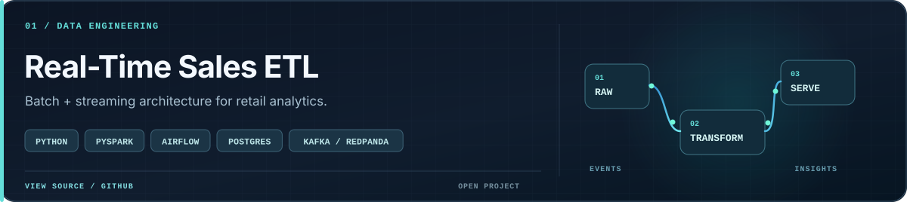
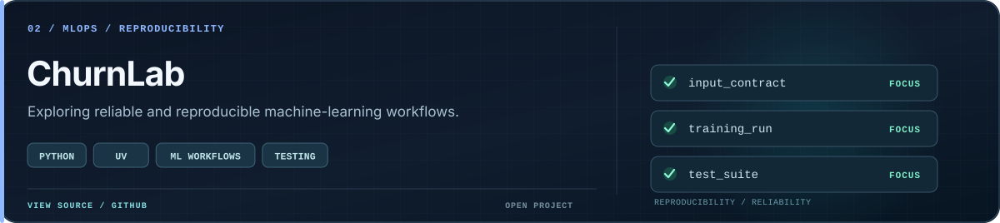
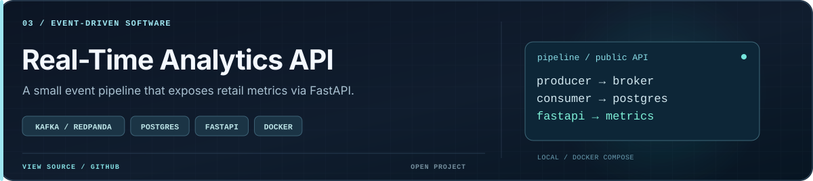
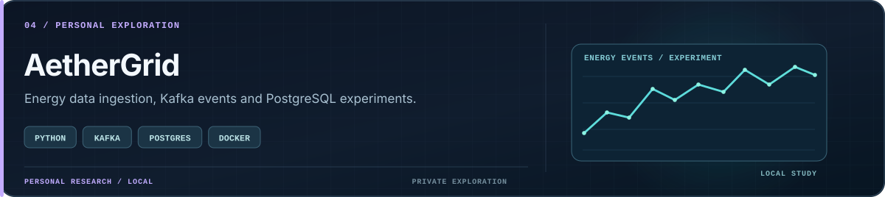

<!--
GitHub profile README for @alhousseynou-ndiaye.
All illustrations are authored as local, self-contained SVGs. No trackers, remote badge services, or scripts.
-->

<picture>
  <source media="(max-width: 620px)" srcset="assets/hero-mobile.svg">
  
</picture>

**Designing reliable systems. Building useful products.**

[Selected work](#selected-work) &nbsp;·&nbsp; [Engineering stack](#engineering-stack) &nbsp;·&nbsp; [Get in touch](#get-in-touch)

 

### Hi, I'm Alhousseynou.

I work at the intersection of **data engineering, applied AI, and software development**. My focus is on building systems that turn complex data into dependable workflows and practical products.

- **Currently:** Data & Performance Marketing apprentice at **Babilou**, working on analytics, reporting, and data-driven business problems.
- **Studying:** MSc **Data Engineering & Artificial Intelligence** at **ESILV**, France.
- **Motivated by:** Distributed data systems, reliable machine learning, and software products that solve real problems.

### What I focus on

<picture>
  <source media="(max-width: 620px)" srcset="assets/focus-mobile.svg">
  
</picture>

## Selected work

The projects below are hands-on engineering work and learning projects — not claims of enterprise production deployment.

An end-to-end retail analytics project combining batch processing, **PySpark transformations**, **Airflow orchestration**, a Kafka-compatible streaming flow, PostgreSQL analytical layers, and a Streamlit dashboard. **[Explore the repository →](https://github.com/alhousseynou-ndiaye/real-time-sales-etl-pipeline)**

A hands-on MLOps learning project centered on **reproducible workflows**, experimentation, and reliable development practices. The linked public repository currently contains the initial course project. **[Explore the repository →](https://github.com/alhousseynou-ndiaye/churnlab-tp01)**

A compact event-driven architecture: **producer → Redpanda/Kafka → consumer → PostgreSQL → FastAPI**. Designed to explore streaming ingestion and the delivery of analytics through an API. **[Explore the repository →](https://github.com/alhousseynou-ndiaye/realtime-analytics-platform)**

### In the lab

**AetherGrid** is an energy-data engineering exploration involving ingestion, event streaming, and PostgreSQL experiments. The repository is not publicly accessible, so no public source link is shown.

## Engineering stack

| Area | Tools and practices |
| :--- | :--- |
| **Data engineering** | Python · SQL · PostgreSQL · Apache Kafka / Redpanda · Apache Airflow · PySpark |
| **Machine-learning workflows** | Python · reproducibility · model experimentation · pytest · uv · pre-commit |
| **Applications & analytics** | FastAPI · Streamlit · Plotly · analytics dashboards |
| **Developer workflow** | Docker · Docker Compose · Git · GitHub · automated checks |

Technologies above reflect hands-on work or publicly documented learning projects; they are not claims of expert-level proficiency in every tool.

## Professional practice

At **Babilou**, I contribute to data-intensive business work across recruitment analytics, marketing performance, and acquisition reporting. My focus includes Python-based transformations, analytical workflows, and interactive decision-support dashboards.

*Internal source code, business data, and performance figures remain confidential.*

## Currently exploring

**Cloud data platforms** · **Distributed processing** · **MLOps reliability** · **SaaS product engineering**

I care about the full journey from **data ingestion** to **dependable software** — and about whether a system actually helps people make better decisions.

## Get in touch

For engineering conversations, collaboration, or opportunities:

**[Email me](mailto:cirendiaye409@gmail.com)** &nbsp;·&nbsp; **[GitHub](https://github.com/alhousseynou-ndiaye)**

---

Thoughtful systems. Practical products. Continuous learning.

