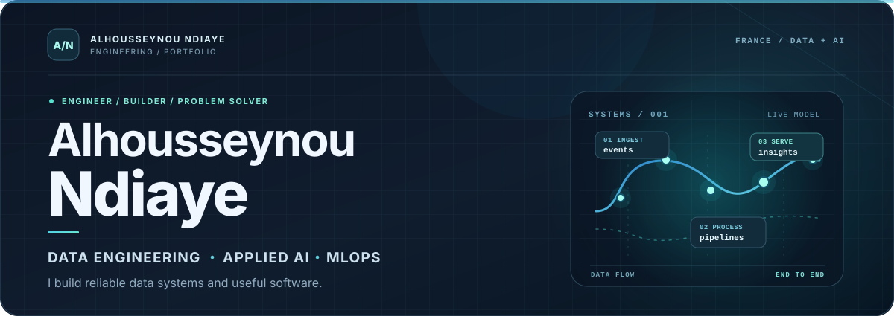
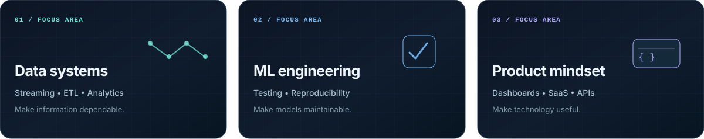

<!--
  Alhousseynou Ndiaye | GitHub Profile
  Original self-hosted SVG artwork. No remote image services, scripts, or analytics trackers.
-->

<picture>
  <source media="(max-width: 620px)" srcset="assets/hero-mobile.svg">
  
</picture>

**Engineering data systems. Building intelligent products. Making data useful.**

[Featured work](#featured-work) &nbsp;·&nbsp; [Engineering toolkit](#engineering-toolkit) &nbsp;·&nbsp; [Let's connect](#lets-connect)

 

### Building where data meets decisions.

I'm **Alhousseynou**, an engineering-minded builder working across **data engineering, applied AI and software development**. I enjoy turning messy inputs into dependable pipelines, clear analytical products and systems that are easier to understand and maintain.

- **At work:** Data & Performance Marketing apprentice at **Babilou**, France.
- **At university:** MSc in **Data Engineering & Artificial Intelligence**, **ESILV**.
- **Beyond the classroom:** Building projects in event streaming, ML reliability and API-driven analytics.

## Engineering in practice

**Babilou — Data & Performance Marketing**  
I work on internal data and decision-support challenges spanning **recruitment analytics, acquisition performance and lead scoring**. My contributions involve Python-based data transformations, reporting workflows and interactive dashboards built for business teams.

The most valuable part of this work is connecting technical rigor with the needs of people making everyday decisions.

## Areas of focus

<picture>
  <source media="(max-width: 620px)" srcset="assets/focus-mobile.svg">
  
</picture>

## Featured work

### 01 / Data engineering · Batch + streaming

A retail analytics pipeline bringing together **batch ETL, PySpark, Airflow orchestration and Kafka-compatible streaming** to produce PostgreSQL-backed metrics and a Streamlit dashboard. **[View code](https://github.com/alhousseynou-ndiaye/real-time-sales-etl-pipeline)**

### 02 / Machine learning · Reproducibility

A hands-on MLOps project treating ML as software: **reproducible training, input validation, saved pipelines, MLflow experiment tracking and automated testing**. **[View code](https://github.com/alhousseynou-ndiaye/churnlab-tp01)**

### 03 / Event-driven systems · Analytics API

An event-driven analytics prototype connecting **producers, a Kafka-compatible broker, PostgreSQL aggregates and FastAPI endpoints**. **[View code](https://github.com/alhousseynou-ndiaye/realtime-analytics-platform)**

### 04 / Engineering lab · Energy data

**AetherGrid** is my private engineering sandbox for energy-data ingestion, Kafka event streaming, PostgreSQL storage and replay experiments.

## Engineering toolkit

| Domain | Technologies and practices |
| :--- | :--- |
| **Data platforms** | Python · SQL · PostgreSQL · Kafka / Redpanda · PySpark · Airflow |
| **ML engineering** | scikit-learn · MLflow · pytest · uv · pre-commit · reproducible workflows |
| **Analytics & APIs** | Streamlit · Plotly · FastAPI |
| **Developer workflow** | Docker · Docker Compose · Git · GitHub |

## On my radar

**Cloud data platforms** · **Distributed systems** · **MLOps reliability** · **SaaS product engineering**

My long-term focus is end-to-end engineering: from data ingestion and model experimentation to useful software products.

## Let's connect

I enjoy discussing **data platforms, applied AI, product engineering and real-world technical problems**.

**[Email me](mailto:alh.ndiaye27@gmail.com)** &nbsp;·&nbsp; **[Explore my repositories](https://github.com/alhousseynou-ndiaye?tab=repositories)**

---

Built with intent. Backed by engineering. Always learning.

